<p align="center">
  <picture>
    <source media="(prefers-color-scheme: dark)" srcset="docs/assets/hero-dark.svg">
    <source media="(prefers-color-scheme: light)" srcset="docs/assets/hero-light.svg">
    
  </picture>
</p>

<h1 align="center">NeuraCart</h1>

<p align="center">
  <strong>The AI-native neighbourhood market.</strong><br>
  Forecast the demand. Substitute the gap. Route the rider. Answer the customer — in one continuous loop.
</p>

<p align="center">
  
  
  
  
  
  
  
  
  
  
</p>

<p align="center">
  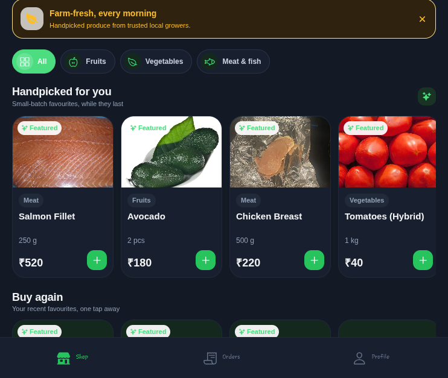
  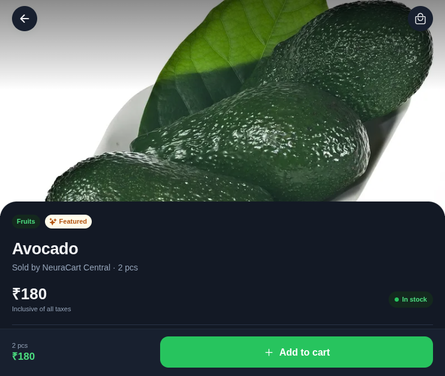
  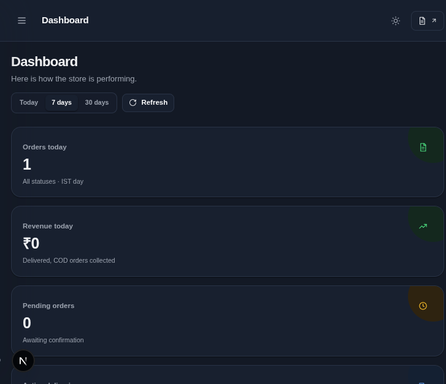
  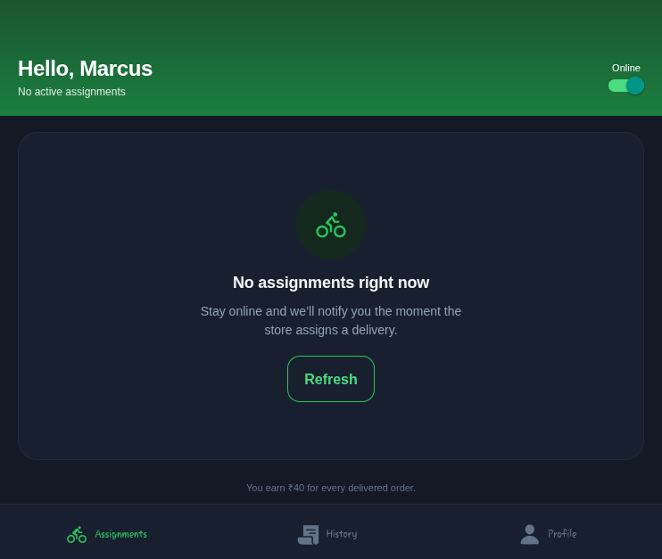
</p>

<p align="center"><em>One product, three surfaces, one API. Real screenshots from the running build.</em></p>

---

## What is NeuraCart?

NeuraCart is a **full-stack grocery delivery platform for a single neighbourhood store** — fruits, vegetables, and meat, delivered from a real shop in Bengaluru. It is not a demo CRUD app: it has the boring parts a store actually needs (stock, slots, riders, refunds, audits) **and** an AI layer that is woven into the product instead of bolted onto a chat box.

Three apps talk to one typed API:

| Surface | Who it is for | Stack | What it does |
|---|---|---|---|
| **Customer app** | Shoppers | Expo SDK 57 · React Native · Expo Router · Zustand | OTP / Google sign-in, catalogue, cart, slots, pickup, COD + Razorpay, wallet, subscriptions, live tracking, reviews, help chat, AI assistant, EN/KN/HI, dark mode |
| **Admin panel** | Store manager | Next.js 15 App Router · CSS design system | Orders, products, flash deals, slots, subscriptions, reviews, recipes, risk flags, AI console, riders, store settings, light/dark |
| **Rider app** | Delivery partners | Expo SDK 57 · React Native · Expo Router | Assignment board, paired batches, foreground GPS, proof of delivery, earnings, push, dark mode |
| **API** | All of the above | Express 5 · TypeScript · Prisma 5.22 · PostgreSQL 18 | Auth, catalogue, orders, money, logistics, scheduling, deals, AI, notifications, realtime SSE, uploads |

**The bet:** a small store should not need a data team to act like a big one. The same AI loop that drafts a purchase order also answers “what can I cook with this?” and reroutes a rider around rain.

---

## The 60-second tour

<table>
  <tr>
    <td align="center">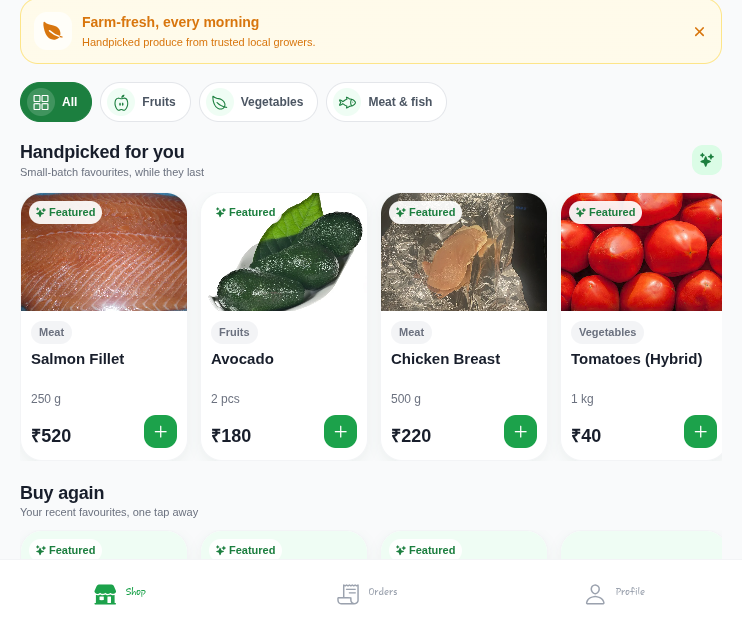<br><sub><b>Home</b> — live catalogue, search, AI entry point</sub></td>
    <td align="center">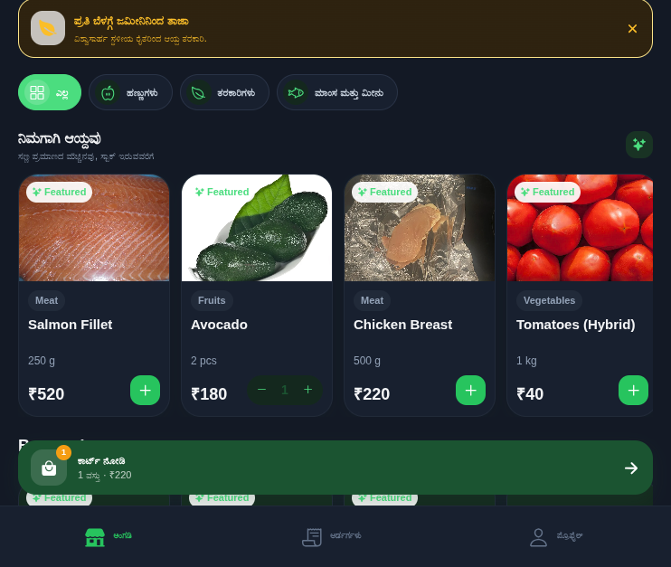<br><sub><b>ಕನ್ನಡ</b> — the same screen, localised</sub></td>
    <td align="center">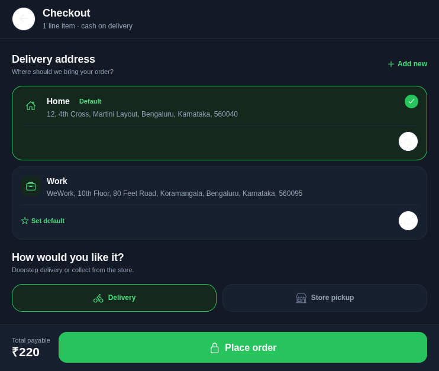<br><sub><b>Checkout</b> — slots, pickup, wallet, COD/UPI</sub></td>
    <td align="center">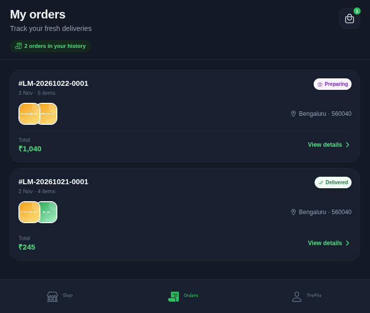<br><sub><b>Orders</b> — live status, reorder, track</sub></td>
  </tr>
  <tr>
    <td align="center">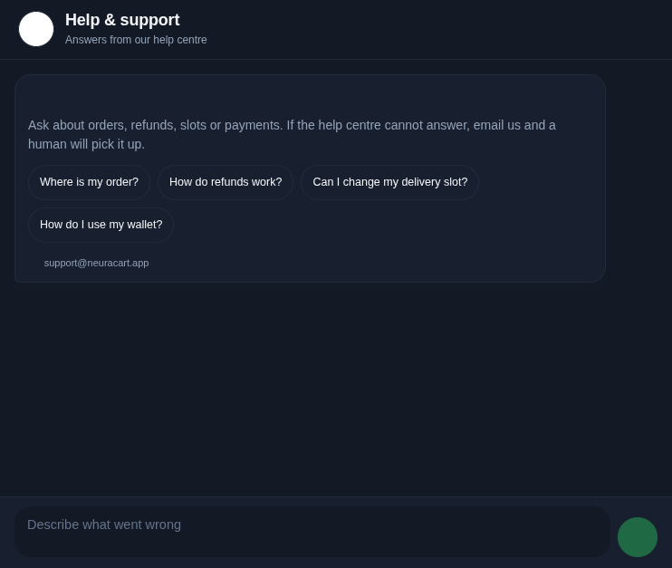<br><sub><b>Help</b> — grounded support chat</sub></td>
    <td align="center">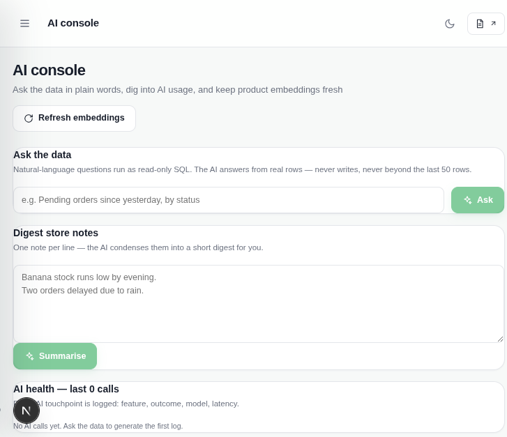<br><sub><b>AI console</b> — ask the data, audit jobs</sub></td>
    <td align="center">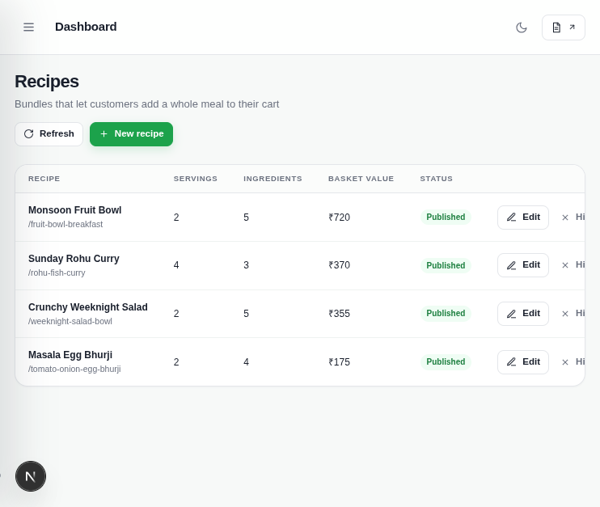<br><sub><b>Recipes</b> — editorial + AI drafts</sub></td>
    <td align="center">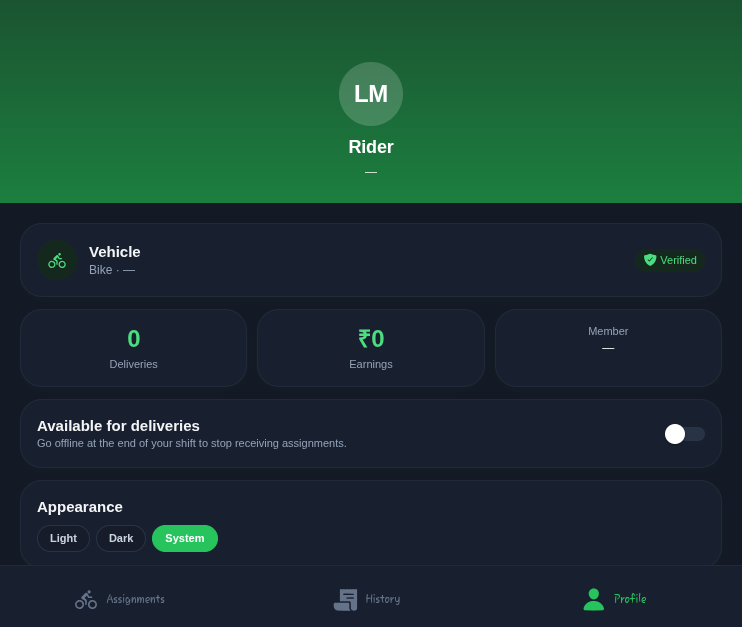<br><sub><b>Rider</b> — earnings, availability, theme</sub></td>
  </tr>
</table>

<p align="center">
  
</p>

---

## Why this is an AI project, not “a market app with a chatbot”

Every AI feature shares one pipeline: **signal → context → guardrails → model or deterministic fallback → typed action + audit log**. That is why the app still works with **no API key at all** — the fallback is a first-class path, not an error state.

| AI feature | What the customer / manager sees | Without `GEMINI_API_KEY` |
|---|---|---|
| **Shopping assistant** | “Something quick for two, under ₹400, no onion” → a reply plus a cart proposal | Rule-based intent parser over the catalogue |
| **Semantic search** | “breakfast for a toddler” finds eggs, oats, bananas | Keyword + category expansion |
| **Vision search** | Snap a shelf or a dish → matching products | Filename/type-safe rejection + text fallback |
| **Smart substitutes** | Out-of-stock item → same-use, same-budget alternatives | Deterministic similarity by category, price band, stock |
| **Recipe → cart** | “Pasta for four” → recipe steps + one-tap basket | Curated recipe templates |
| **Help chat** | Order-aware support answers, no hallucinated policies | Grounded FAQ + order lookup |
| **Admin NL-ops** | “Which products will run out this week?” → answer + read-only SQL | Fixed analytics queries |
| **Demand forecast** | 7-day moving-average demand + stock-cover alerts | Pure SQL/statistics, no model needed |
| **Catalogue drafts** | Photo → name, description, category, price suggestion | Manual form with validation |
| **Risk flags** | Rapid cancellations, COD abuse, duplicate accounts | Deterministic thresholds |
| **Order summaries** | Manager digest of the day | Template summary |

**Guardrails, not vibes:** token buckets per feature, 429 backoff, a circuit breaker, read-only `SELECT`-only SQL capped at 50 rows, prompt/response audit logs, and an explicit `usedFallback` flag on every response. The admin console shows latency, model, status, and fallback rate per job.

---

## Everything in the box

### Customer app

- **Auth** — email OTP (hashed, rate-limited, 10-minute expiry) and **Google sign-in** when OAuth credentials are configured. JWT access tokens (15 min) + rotating refresh tokens (7 days) with reuse detection.
- **Shopping** — 38 fruits, vegetables, and meat SKUs with real CC-licensed photography, category tabs, search, featured rails, product detail, stock awareness, quantity stepper, cart persisted per user.
- **Checkout** — saved addresses, delivery vs store pickup, two-hour slots with capacity, wallet redemption, loyalty points, COD or online payment, order notes.
- **After the order** — live status timeline, rider tracking map, cancellation windows, reorder, ratings and reviews, invoice-style totals.
- **Money** — wallet ledger, loyalty tiers, referral code, near-expiry flash deals.
- **Subscriptions** — recurring baskets that generate orders on demand.
- **Help** — grounded support chat plus a human hand-off path.
- **Preferences** — dietary needs, language (EN / ಕನ್ನಡ / हिन्दी), **light / dark / system theme**.
- **AI** — assistant, semantic search, vision search, substitutes, recipe ideas.

### Admin panel

- **Dashboard** — today vs 7-day revenue, orders by status, low-stock list, live queue, demand forecast with stock-cover alerts.
- **Orders** — filter, inspect, confirm → prepare → assign → out for delivery → delivered; cancel with reason; dispatch suggestions; batching; proof-of-delivery review.
- **Catalogue** — create/edit products with image upload (sharp, 5 MB cap), stock, price, category, featured/active toggles.
- **Growth** — flash deals, delivery slots and capacity, subscriptions, reviews moderation.
- **Kitchen** — recipes with ingredients linked to real products; publish/unpublish.
- **Trust** — risk flags with severity and resolution notes.
- **AI console** — natural-language questions over the store data, job log, embedding backfill, catalogue drafts.
- **Operations** — rider roster, availability, assignments, store open/closed override, service pincodes.
- **Theme** — full light/dark token set with a persistent top-bar toggle.

### Rider app

- Password login, availability toggle, assignment board with accept/decline.
- Paired batches, pickup checklist, foreground GPS streaming.
- Proof of delivery: 4-digit customer OTP + photo.
- Earnings and delivery history, push notifications, theme switch.

### Platform

- **API layering** — route → middleware → controller → service → repository → Prisma. Controllers never touch Prisma; repositories hold no business logic.
- **Validation** — Zod at every boundary, typed query/body schemas, consistent error envelope with request IDs.
- **Realtime** — Server-Sent Events (`GET /api/updates?token=…`) for order and assignment changes.
- **Notifications** — Expo push (FCM), Resend email, optional WhatsApp Cloud API; every channel degrades gracefully.
- **Payments** — COD default; UPI intent with admin verification; Razorpay test mode + signed webhook when keys exist.
- **Uploads** — local disk in dev, MIME allow-list, sharp resize; swap for S3 in production.
- **Observability** — structured logs, AI job audit table, health endpoint.

---

## Architecture

<p align="center">
  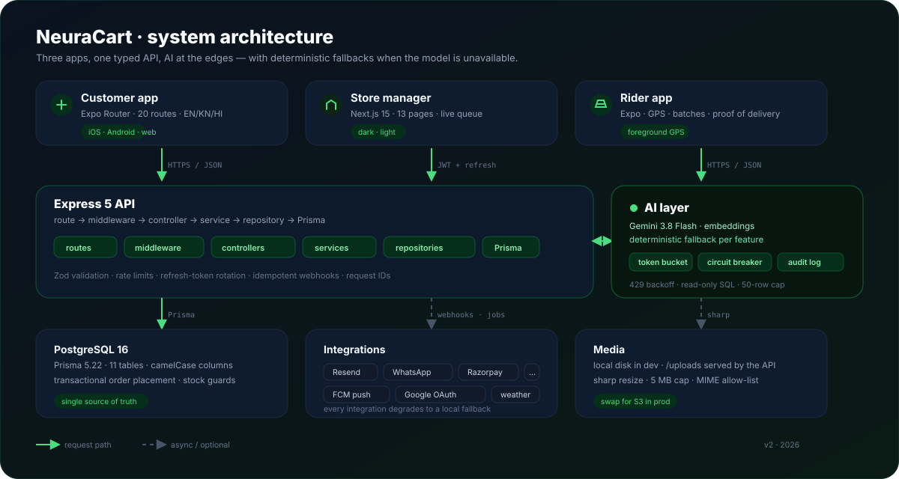
</p>

```text
Customer (Expo) ─┐
Admin (Next.js) ─┼── HTTPS/JSON ──> Express 5 API ──> PostgreSQL 18 (Prisma)
Rider (Expo) ────┘                        │
                                          ├── AI layer (Gemini + fallbacks, audit log)
                                          ├── Resend · WhatsApp · FCM
                                          ├── Razorpay (test mode) + webhook
                                          └── local uploads (sharp)
```

The full request lifecycle, state machines, schema, and endpoint contract live in **[`plan.md`](./plan.md)**. The short version:

- Order status: `pending → confirmed → preparing → assigned → out_for_delivery → delivered` (plus `cancelled`).
- Stock is decremented inside a transaction at order placement; failures roll back cleanly.
- Money is integer paise internally; INR and GST-inclusive at the edge.
- All timestamps are stored in UTC and rendered in `Asia/Kolkata`.

---

## Quick start

### Prerequisites

- **Node.js 20 LTS** + npm
- **Docker** (PostgreSQL 18) — or your own PostgreSQL
- **Expo Go** on a phone, or an iOS/Android simulator (optional; web works too)

### 1. Clone and install

```bash
git clone <your-fork-url> neuracart
cd neuracart

npm install
(cd backend && npm install)
(cd admin && npm install)
(cd delivery && npm install)
```

### 2. Start PostgreSQL

```bash
docker compose up -d
```

Database, user, and password are all `neuracart` on port `5432`.

### 3. Configure the API

```bash
cp backend/.env.example backend/.env
```

Generate the three secrets and paste them into `backend/.env`:

```bash
openssl rand -hex 32   # JWT_ACCESS_SECRET
openssl rand -hex 32   # JWT_REFRESH_SECRET
openssl rand -hex 32   # OTP_PEPPER
```

Everything else has a sensible local default. Email, Google, Gemini, Razorpay, and WhatsApp are **optional** — see the [credentials table](#credentials--optional-integrations).

### 4. Migrate and seed

```bash
cd backend
npx prisma migrate deploy
npm run db:seed
cd ..
```

The seed creates the store, **38 products** across fruits, vegetables, and meat, recipes, slots, deals, a manager, a customer, and 10 riders. Every product ships with a real, CC-licensed photograph from Wikimedia Commons (committed under `backend/uploads/seed/`); see [`docs/IMAGE_CREDITS.md`](./docs/IMAGE_CREDITS.md) for attribution.

### 5. Run all four processes

```bash
# Terminal 1 — API
cd backend && npm run dev            # http://localhost:8000

# Terminal 2 — customer app
npm start                            # http://localhost:8081

# Terminal 3 — admin panel
cd admin && npm run dev              # http://localhost:3000

# Terminal 4 — rider app
cd delivery && npm start             # http://localhost:8082
```

> **On a physical phone**, `localhost` is the phone itself. Set `EXPO_PUBLIC_API_URL=http://<your-LAN-IP>:8000` before starting the Expo apps, and add your LAN origin to `CORS_ORIGINS` in `backend/.env`.

### 6. Sign in

| Role | Email | Credential |
|---|---|---|
| **Store manager** | `admin@neuracart.app` | email OTP — the dev code appears in the UI and in the API response |
| **Customer** | `customer@neuracart.app` | email OTP — same dev shortcut |
| **Riders** | `driver1@neuracart.app` … `driver10@neuracart.app` | `NeuraCart@123` |

OTP delivery is disabled locally by design: the API returns `devOtp`, and the sign-in screen shows a one-tap “Use code” shortcut. Add `RESEND_API_KEY` to send real email.

---

## Credentials & optional integrations

Nothing below is required to run the app. Each one unlocks a real integration; without it the product uses the deterministic fallback described above.

| Variable(s) | Unlocks | Where to get it | Local behaviour without it |
|---|---|---|---|
| `DATABASE_URL` | PostgreSQL | `docker compose up -d` | — (required) |
| `JWT_ACCESS_SECRET`, `JWT_REFRESH_SECRET`, `OTP_PEPPER` | Secure sessions and OTP hashing | `openssl rand -hex 32` | — (required) |
| `RESEND_API_KEY`, `EMAIL_FROM` | Real OTP and order email | [resend.com](https://resend.com) → API Keys | OTP returned as `devOtp`; no email sent |
| `GOOGLE_CLIENT_ID`, `GOOGLE_CLIENT_SECRET` | **Continue with Google** | [Google Cloud Console](https://console.cloud.google.com/apis/credentials) → OAuth 2.0 Client ID (Web) | Button renders disabled with an inline hint; API returns `503 GOOGLE_NOT_CONFIGURED` |
| `GEMINI_API_KEY` | Real Gemini calls for chat, search, drafts | [Google AI Studio](https://aistudio.google.com/apikey) | Every AI feature falls back deterministically |
| `RAZORPAY_KEY_ID`, `RAZORPAY_KEY_SECRET`, `RAZORPAY_WEBHOOK_SECRET` | Online card/UPI payments + signed webhook | [Razorpay Dashboard](https://dashboard.razorpay.com) → Test mode | COD and manual UPI verification only |
| `WHATSAPP_TOKEN`, `WHATSAPP_PHONE_ID` | WhatsApp order updates | [Meta WhatsApp Cloud API](https://developers.facebook.com/docs/whatsapp/cloud-api) | Email/push only |
| `EXPO_PUBLIC_API_URL` | Phone ↔ local API | Your LAN IP | `localhost:8000` (simulator/web only) |
| `NEXT_PUBLIC_API_URL` | Admin ↔ API | `http://localhost:8000/api` | Same default |

### Google OAuth setup (2 minutes)

1. Create a project in Google Cloud Console → **APIs & Services → Credentials**.
2. **Create credentials → OAuth client ID → Web application**.
3. Authorised redirect URI: `http://localhost:8000/api/auth/google/callback`.
4. Copy the client ID and secret into `backend/.env`:

```bash
GOOGLE_CLIENT_ID=...apps.googleusercontent.com
GOOGLE_CLIENT_SECRET=...
GOOGLE_REDIRECT_URL=http://localhost:8000/api/auth/google/callback
```

5. Restart the API. `GET /api/auth/google/status` should now return `{ "configured": true }`, and the customer sign-in screen enables the Google button.

> **What I need from you to live-test this:** a Google OAuth **client ID** and **client secret** for the redirect above. Until then the flow is scaffolded and safe, but I cannot complete a real Google round-trip.

---

## How to use it

### As a customer

1. Open **http://localhost:8081** → enter `customer@neuracart.app` → **Send OTP** → tap **Use code** → verify.
2. Browse by category, or tap **Ask the assistant** and type *“something quick for two under ₹400”*. Add the proposal to the cart.
3. Open a product, change quantity, add to cart. Out-of-stock items suggest substitutes.
4. **Cart → Checkout**: pick an address, delivery or pickup, a two-hour slot, wallet redemption, then **Place order** (COD default).
5. Track the order, rate it when delivered, reorder in one tap.
6. **Profile** → switch **Appearance** (Light / Dark / System) and **Language** (English / ಕನ್ನಡ / हिन्दी). Both persist per device.

### As the store manager

1. Open **http://localhost:3000** → `admin@neuracart.app` → OTP.
2. **Dashboard** shows today vs 7-day performance, low stock, and the live queue.
3. Open an order → **Confirm → Prepare → Assign rider**. Dispatch suggestions rank available riders; batching pairs nearby orders.
4. **Products** → create or edit, upload an image, set stock/price/category.
5. **Flash deals**, **Delivery slots**, **Subscriptions**, **Reviews**, **Recipes**, **Risk flags** — each is a first-class page, not a JSON editor.
6. **AI console** → ask *“Which products will run out this week?”* → answer, SQL, and a job log entry. Use **Backfill embeddings** after bulk catalogue edits.
7. **Settings** → close the store, change service pincodes, review the day’s digest.

### As a rider

1. Open **http://localhost:8082** → `driver1@neuracart.app` / `NeuraCart@123`.
2. Toggle **Available for deliveries**.
3. Accept an assignment → **Start pickup** → **Start delivery** (foreground GPS streams).
4. At the door, collect the customer’s 4-digit code, take a photo, **Complete delivery**.
5. **History** shows earnings (₹40 per delivered order); **Profile** has the theme switch and availability.

---

## API surface (short version)

Base URL: `http://localhost:8000/api`. Every response uses `{ success, message, data }`; errors add `code` and a request ID.

| Area | Representative endpoints |
|---|---|
| **Auth** | `POST /auth/send-otp`, `POST /auth/verify-otp`, `POST /auth/admin/send-otp`, `POST /auth/refresh`, `POST /auth/logout`, `GET /auth/google/status`, `GET /auth/google`, `GET /auth/google/callback` |
| **Catalogue** | `GET /products`, `GET /products/featured`, `GET /products/:id`, `POST /products`, `PATCH /products/:id`, `PATCH /products/:id/toggle` |
| **Cart & orders** | `POST /orders`, `GET /orders`, `GET /orders/:id`, `POST /orders/:id/cancel`, `POST /orders/:id/review` |
| **Money** | `GET /wallet`, `POST /wallet/redeem`, `GET /wallet/transactions`, `POST /payments/intent`, `POST /payments/webhook`, `POST /payments/:id/verify` |
| **Scheduling** | `GET /slots`, `GET /subscriptions`, `POST /subscriptions`, `PATCH /subscriptions/:id` |
| **Logistics** | `GET /delivery/assignments`, `POST /delivery/assignments/:id/accept`, `POST /delivery/assignments/:id/decline`, `POST /delivery/assignments/:id/status`, `POST /delivery/assignments/:id/pod`, `GET /delivery/earnings` |
| **AI** | `POST /ai/chat`, `GET /ai/chat/sessions`, `POST /ai/search`, `POST /ai/vision-search`, `GET /ai/substitutes`, `POST /ai/support`, `POST /ai/admin/ask`, `POST /ai/admin/catalog-draft`, `POST /ai/admin/summarize`, `GET /ai/admin/jobs`, `POST /ai/admin/embeddings-backfill` |
| **Admin** | `GET /admin/stats`, `GET /admin/orders`, `GET /admin/forecast`, `GET /admin/risk`, `PATCH /admin/risk/:id`, `GET /admin/riders`, `PATCH /admin/store` |
| **Realtime** | `GET /updates?token=…` (SSE) |
| **Ops** | `GET /health` |

The authoritative contract — request/response shapes, validation rules, and status codes — is in [`plan.md`](./plan.md#11-api-specification).

---

## Project layout

```text
neuracart/
├── src/                     # Customer Expo app
│   ├── app/                 # Expo Router routes (screens)
│   ├── components/          # Shared UI
│   ├── constants/design.ts  # Palette + theme proxy
│   ├── lib/                 # API, storage, i18n, push, OAuth
│   └── store/               # Zustand stores (auth, cart, theme, language…)
├── backend/
│   ├── prisma/              # Schema, migrations, seed
│   ├── src/
│   │   ├── modules/         # auth, products, orders, money, logistics, ai…
│   │   ├── middleware/      # auth, validation, rate limits, uploads
│   │   └── utils/           # jwt, events, order numbers, money
│   └── test/logic.test.js   # Node test runner, no extra deps
├── admin/                   # Next.js 15 admin panel
│   ├── app/                 # App Router pages
│   ├── components/          # Shell, icons, UI primitives
│   └── lib/api.ts           # Typed fetch + refresh
├── delivery/                # Rider Expo app
│   └── src/app/             # Routes (assignments, history, profile)
├── docs/
│   ├── assets/              # Animated SVG hero, architecture, AI loop
│   └── evidence/            # Screenshots used in this README
├── plan.md                  # Product + architecture contract
├── architecture.md          # Diagram-first architecture notes
└── docker-compose.yml       # PostgreSQL 18
```

---

## Quality gates

Run these before shipping a change:

```bash
# API
cd backend
npm test                 # order/money/AI guard logic, Node test runner
npm run typecheck
npm run build

# Customer app
npm run lint
npx tsc --noEmit
npm run test:i18n        # key parity across EN / KN / HI

# Admin panel
cd admin && npm run typecheck && npm run build

# Rider app
cd delivery && npm run lint && npx tsc --noEmit
```

**Verified locally:** customer browse → cart → checkout → order detail; admin OTP login → confirm/prepare/assign → product create; rider login → accept → start → complete → earnings; light/dark across all three surfaces; EN/KN/HI on the translated screens; Google button gating; AI fallback paths with no key.

---

## Known limits (honest list)

- **Single store, single city.** Multi-store and multi-warehouse are deliberately out of scope; the schema keeps a `storeId` so it is not a rewrite.
- **i18n is partial by design.** Tabs, home, profile, and help are translated; deeper screens fall back to English. The catalogue is English.
- **No Redis.** OAuth state, rate limits, and the SSE fan-out are in-process. Run one API instance; horizontal scaling needs Redis.
- **Local uploads.** Seed photography is committed for offline demos; manager uploads still land on local disk. Production should swap to S3-compatible storage.
- **Google OAuth needs your credentials.** The code path, state handling, and UI gating are done; the round-trip is untested until keys exist.
- **AI is optional.** With no `GEMINI_API_KEY`, every feature uses a deterministic fallback. That is intentional, not a stub.

---

## Roadmap

- [ ] Live Google OAuth round-trip (needs client ID + secret)
- [ ] Redis-backed rate limits, OAuth state, and SSE fan-out
- [ ] S3-compatible media storage
- [ ] Full-app translation coverage (beyond tabs/home/profile/help)
- [ ] Multi-store tenancy
- [ ] Playwright end-to-end suite committed to CI

---

## Documentation

- **[`plan.md`](./plan.md)** — the complete product, architecture, schema, API, screen, and testing contract.
- **[`architecture.md`](./architecture.md)** — diagram-first system notes.
- **[`docs/evidence/`](./docs/evidence/)** — screenshots used above.
- **[`docs/assets/`](./docs/assets/)** — animated SVG hero, architecture, and AI-loop diagrams.

---

<p align="center">
  <sub>Built as a single-neighbourhood store that happens to think in loops — forecast, substitute, route, answer.</sub><br>
  <sub>Private project. See <a href="./LICENSE">LICENSE</a>.</sub>
</p>
