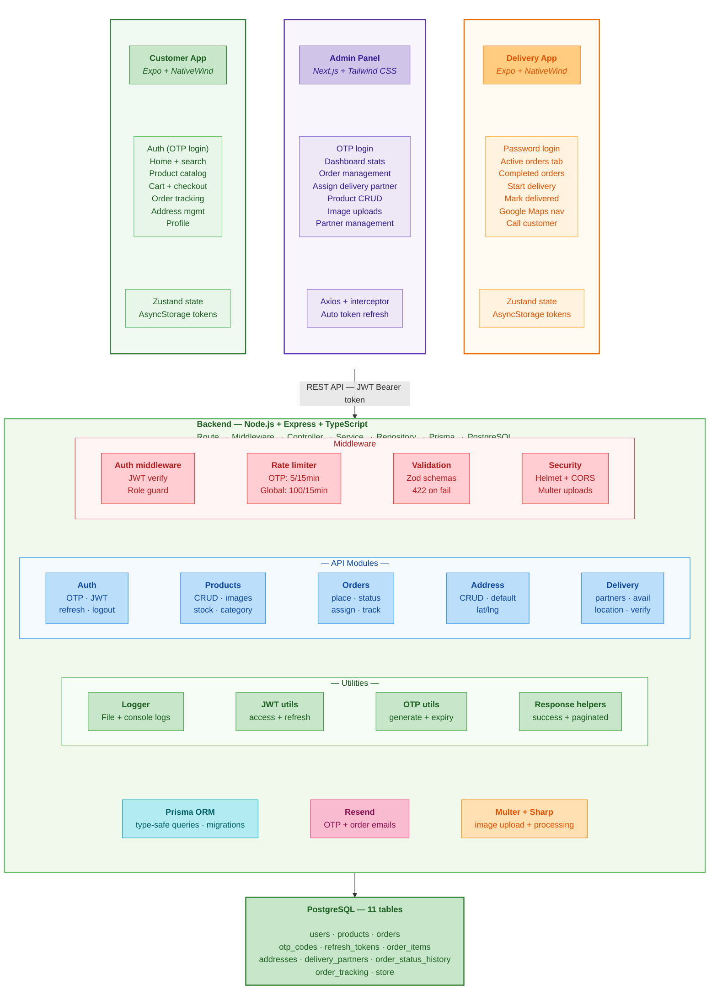

# NeuraCart — System Architecture

> The authoritative specification is [`plan.md`](./plan.md). This diagram was extracted from the original design images (where the product was called LocalCart) and is kept as an architecture reference.

Extracted from the architecture diagram.

---

## PostgreSQL — 11 tables

| Row 1 | Row 2 | Row 3 |
|---|---|---|
| `users` | `products` | `orders` |
| `otp_codes` | `refresh_tokens` | `order_items` |
| `addresses` | `delivery_partners` | `order_status_history` |
| `order_tracking` | `store` | |

## Legend

| Colour | Meaning |
|---|---|
| Green | Customer App |
| Purple | Admin Panel |
| Orange | Delivery App |
| Red | Middleware |
| Blue | API modules |